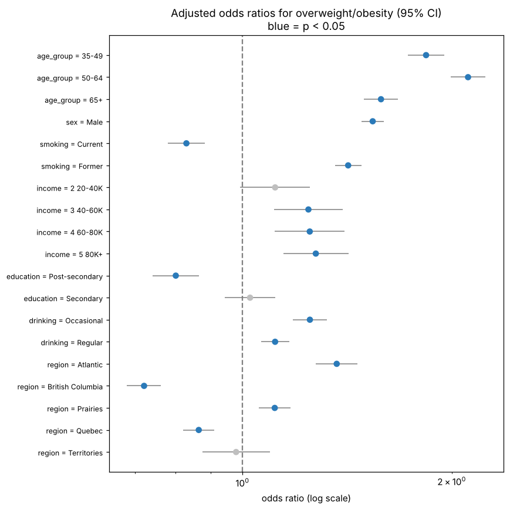
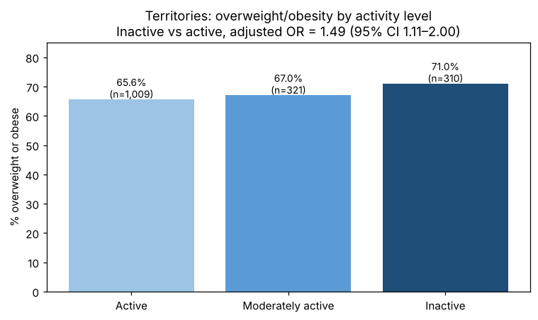
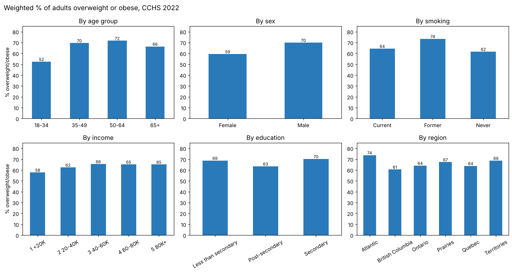

# Risk Factors for Overweight and Obesity — CCHS 2022

Which demographic and behavioural factors are linked to being overweight or obese in Canada? An analysis of **55,395 adults** in Statistics Canada's 2022 Canadian Community Health Survey (CCHS), using survey-weighted prevalence, chi-square tests, 2×2 risk measures and multivariable logistic regression in Python.



## Key findings

**All of Canada**
- **64.7%** of Canadian adults are overweight or obese (survey-weighted estimate).
- **Age** has the strongest association: odds peak at 50–64 (adjusted OR 2.11 vs 18–34).
- **Men** have higher odds than women (OR 1.54).
- **Former smokers** have higher odds than never smokers (OR 1.42); current smokers have lower odds (OR 0.83), consistent with nicotine suppressing appetite.
- **Post-secondary graduates** have 20% lower odds than people without a secondary diploma (OR 0.80).
- **Region:** higher odds in the Atlantic provinces (OR 1.37) and lower in British Columbia (OR 0.72) compared with Ontario.

**Physical activity (territories subsample, n = 1,640)**
- Overweight/obesity: **65.6%** of active, **67.0%** of moderately active and **71.0%** of inactive adults.
- After adjusting for age, sex, smoking and income, **inactive adults have 1.49× the odds** of active adults (95% CI 1.11–2.00, p = 0.007).



## Methods

| Step | What was done |
|---|---|
| Cleaning | Kept adults 18+; recoded CCHS numeric codes into labelled categories; treated "valid skip" and "not stated" codes as missing; complete-case analysis |
| Prevalence | Survey-weighted percentages using the CCHS weight `WTS_M` |
| Association tests | Chi-square tests of independence with Cramér's V for effect size |
| Risk measures | Risk difference, relative risk and crude odds ratio (inactive vs active) |
| Modelling | Multivariable logistic regression (`statsmodels`) with adjusted odds ratios and 95% confidence intervals |



## Limitations

- Cross-sectional survey: results are associations, not causes.
- Height and weight are self-reported, which usually underestimates BMI.
- The public file groups overweight and obese together, so this is not obesity alone.
- Regressions are unweighted (the public file has no bootstrap weights), so confidence intervals are approximate.
- Physical activity questions were asked only in the territories in this file, so that part does not represent all of Canada.

## Data

Statistics Canada, *Canadian Community Health Survey, 2022: Public Use Microdata File* (Catalogue 82M0013X), used under the [Statistics Canada Open Licence](https://www.statcan.gc.ca/en/reference/licence). `data/cchs2022_subset.csv` contains only the 10 variables used here (67,079 respondents). The full file and data dictionary are available from Statistics Canada.

## Background

This builds on a STAT 3530 (Analysis of Observational Data) team project at Memorial University with Syed Ajaz Arham, originally done in R. This version re-implements the analysis in Python, reproduces the original physical-activity model (same sample of 1,640 and the same odds ratio of 1.49), and extends it to a national risk-factor model.

## How to run

```bash
pip install -r requirements.txt
jupyter notebook notebooks/obesity_risk_factors.ipynb
```

## Repository structure

```
├── data/cchs2022_subset.csv              10 CCHS variables used
├── notebooks/obesity_risk_factors.ipynb  full analysis
├── images/                               charts and result tables (CSV)
├── requirements.txt
└── README.md
```

*Author: Mohammed Mudabbir Ahmed · B.Sc. Data Science, Memorial University of Newfoundland · [LinkedIn](https://www.linkedin.com/in/mmudabbirahmed)*
